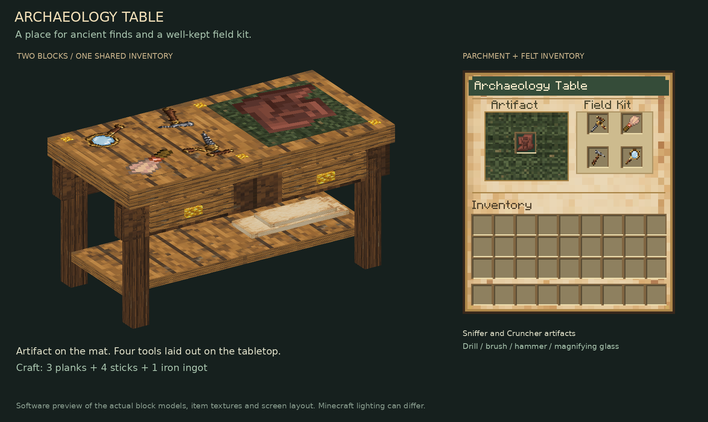
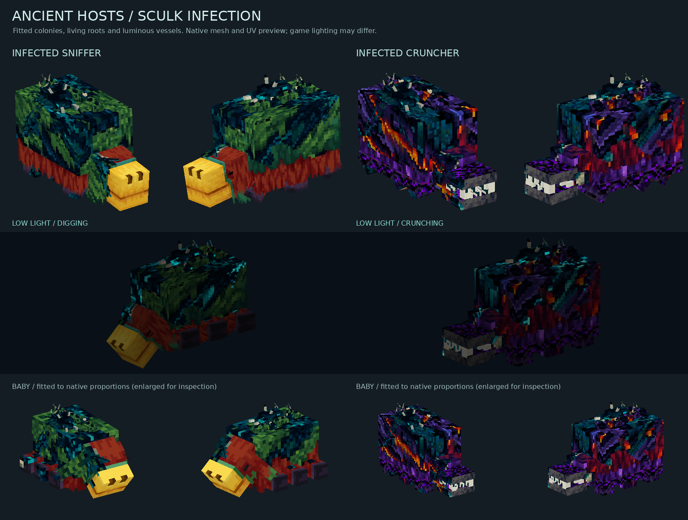
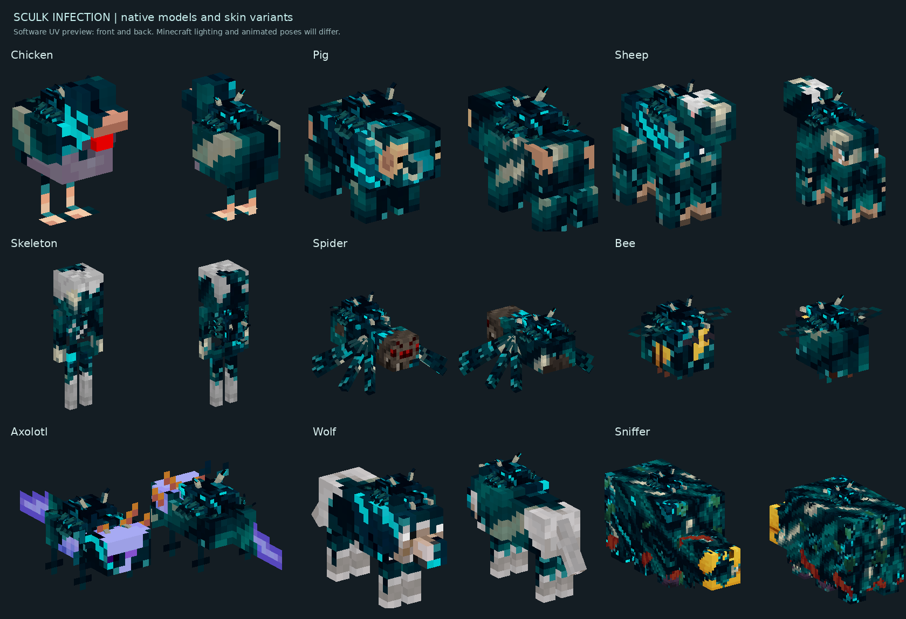
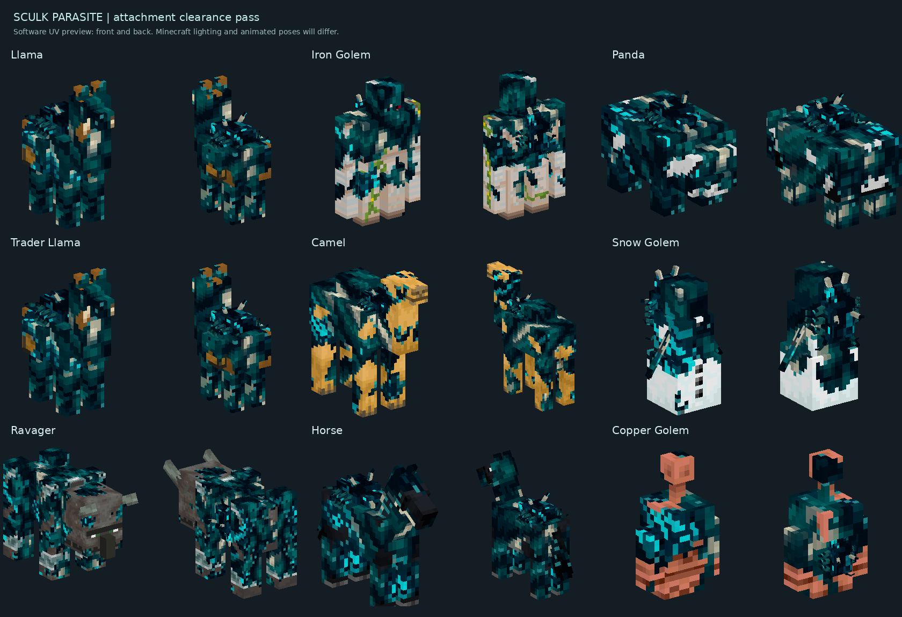

# Minecraft: Sniffer Head

A NeoForge mod for Minecraft 26.3 using Java 25. **Sniffer Head** is a placeable
sniffer head with a red head, floppy ears, and yellow snout. Find it in the
Building Blocks creative tab or Example Mod Tab. Side placements sit flush against the wall and face outward from the clicked block face;
top placements face the player in 16 steps of 22.5 degrees, including diagonals.

Sniffers drop one Sniffer Head on death when mob loot is enabled. It has no
random drop chance or Looting bonus, and does not require a player kill.

Start with [the beginner guide](START_HERE.md) for setup, run commands, and an
explanation of the Java and JSON files. Open this repository folder directly
in IntelliJ as a Gradle project; the original template ZIP is kept for reference.

Existing Example Blocks turn into Sniffer Heads: the saved block and item ID
remains `examplemod:example_block`. The model references the vanilla sniffer
texture, so no copy of Minecraft's texture is bundled in this repository.

The template's example food item, configuration, and logging remain in place.

## Sniffing ancient debris

Adult sniffers can dig exposed, reachable ancient debris on a walkable surface.
When their normal digging animation reaches its reward moment, the debris
breaks and drops **one Netherite Scrap** and **one Ancient Artifact** instead of
seeds or an ancient debris block. Buried debris is untouched. Mob griefing must
be enabled. Normal sniffer restrictions and digging cooldowns still apply.

Ancient Artifact is a placeholder item using a vanilla pottery-sherd icon. Find
it in Ingredients or Example Mod Tab, or use `/give @s examplemod:ancient_artifact`.

## Cruncher progression

A successful ancient-debris excavation has a **1-in-15 chance (about 6.7%)** to
also drop **one Cruncher Egg**, matching the vanilla Sniffer Egg chance from
warm-ocean-ruin suspicious sand. Scrap and the ordinary artifact remain guaranteed.
Place the egg with room above it: it hatches into a baby Cruncher on the vanilla
Sniffer Egg timing: about **20 minutes**, or **10 minutes on warped nylium**, plus a small
random delay for each of its three stages.
The baby grows up after about **one minute** in this testing build.

The Cruncher is a passive, fire-immune Nether relative of the sniffer with six
legs, a charcoal/magma hide, and oversized animated jaws. Adult Crunchers search
within eight blocks for reachable Ancient Geodes, walk beside them, and crunch
them into **one Rare Ancient Artifact**. Geodes come from ominous-vault rewards
with a **20% chance (1 in 5)** per reward. Normal vaults do not gain them.
The geode has a stepped dragon-egg shape with a dark shell and purple crystal.

Feed Crunchers **Wither Roses** to breed them; they lay a hatchable Cruncher Egg.
Wither Roses also speed up baby growth, and Crunchers follow players holding them.

Cruncher Egg and Ancient Geode are in Natural Blocks and Example Mod Tab.
**Cruncher Spawn Egg** is in Spawn Eggs and Example Mod Tab; using it immediately
spawns an adult Cruncher. Its Nether-colored icon uses the vanilla magma-cube
spawn-egg texture. Give it with `/give @s examplemod:cruncher_spawn_egg`.
Rare Ancient Artifact is in Ingredients and Example Mod Tab. These items can be
obtained with `/give`; the mob can be spawned with `/summon examplemod:cruncher`.
Both artifacts remain placeholders for future components. Crunchers do not
spawn naturally yet; eggs are their survival acquisition route.

## Archaeology Table

Craft one **Archaeology Table** from **three planks, four sticks and one iron ingot**:

```text
Plank  Plank  Plank
Stick  Iron   Stick
Stick         Stick
```

It occupies **two blocks across and one block deep**. Both spaces must be clear
when placing it. Face a different direction to rotate the table; click either
half to open the same inventory. Find it in Functional Blocks or Example Mod Tab.

The parchment-and-green-felt screen has one artifact slot and four dedicated tool
slots: **drill, brush, hammer and magnifying glass**. It accepts both **Ancient
Artifact** (Sniffer) and **Rare Ancient Artifact** (Cruncher). Each slot holds one
item. Shift-click routes supported items to their matching slots. The artifact
rests on the table's green mat, and all four inserted tools appear on the other
half of the tabletop. Empty slots show faint tool guides with hover labels.

Use Minecraft's normal **Brush**. The three new field tools are also craftable:

- **Archaeology Drill:** two iron ingots, one redstone dust and two sticks.
- **Archaeology Hammer:** two iron ingots and two sticks.
- **Magnifying Glass:** one glass pane, one iron ingot and one stick.

Find the tools in Tools & Utilities or Example Mod Tab. Picking up a stick
unlocks the four new recipes in the recipe book. This first stage stores and
displays artifacts and tools; artifact processing can be added later.

Items and their components persist through saves. Nearby players see inventory
changes on the tabletop, including when loading the chunk. Breaking either half
removes the whole table, drops one table in Survival, and returns its contents.
Closing the screen leaves the items stored. Existing tables require no special
setup after restarting the game.



This is a software preview using the actual block geometry, item textures and
screen layout; Minecraft lighting can differ. For a quick in-game check, craft
the table, add either artifact and all four tools, then close the screen and
walk around it. Reopen from the other half, save/reload, and break either side.
The regression suite checks all four facings, both halves, blocked placement,
slot rules, shift-click, component persistence, crafting and duplicate-free drops.
The client check verifies the real tabletop item submission transforms and neutral
overlay coordinates.

For testing, use `/give @s examplemod:archaeology_table`,
`/give @s examplemod:archaeology_drill`, `/give @s examplemod:archaeology_hammer`
and `/give @s examplemod:magnifying_glass`.

## Cruncher and egg visuals

The hatchable Cruncher Egg has a custom flat obsidian-and-magma inventory icon.
All three egg stages keep their netherrack, basalt, and crying-obsidian transition,
with animated magma veins across every face. The Cruncher keeps the sniffer's
moss fringe and six-legged silhouette, with a Nether recolor, crying-obsidian
body, animated shell veins, armored jaw hinges, and individual crushing fangs.


This preview is rendered from the actual model UVs and texture frames; in-game
lighting can differ. Texture animation is handled by the client renderer and
block texture metadata. Feeding, hatching, AI, drops, loot chances, collision,
and combat behavior are unchanged by this visual update.


## Sculk Parasite

A small, six-legged sculk creature seeks a nearby **eligible Minecraft mob**, leaps onto
it, and merges into the original host. Infection supports land, flying, aquatic,
passive, neutral and hostile mobs, plus this mod's Cruncher. **Players, the Ender
Dragon, Wither and Warden are immune.** The following poor fits are also immune:

- Tadpoles, endermites, silverfish, bats, allays and vexes.
- Ghasts and happy ghasts.
- Cod, salmon, tropical fish, pufferfish, squid and glow squid.

Slimes, magma cubes, blazes, breezes and shulkers remain infectable.
Other mods' entities are not automatically included. One successful infection
consumes one parasite; infected hosts cannot
be reinfected and do not spread infection by attacking.

- **Hostile hosts:** retain native combat, including ranged attacks, with a 30%
  movement attribute bonus, 50% more damage and double their normal XP drops.
  Ordinary loot and zero-XP rules remain in effect.
- **Passive/neutral hosts:** chase and attack Survival/Adventure players. Creative
  and Spectator players are not targets. Their normal movement/navigation is used.
- **Preserved data:** infection keeps the exact native entity, UUID, health, name,
  age, equipment, inventory, owner and variant data. It persists through saving and
  loading and follows native conversions such as a zombie becoming a drowned.
  Infection does not kill the host or duplicate its drops. NoAI remains respected.
- **Save compatibility:** existing Sculk Cow and Sculk Zombie entity IDs and their
  renderers remain available. New infections stay on the native entity type.

Parasites naturally spawn **only in the Deep Dark or Ancient Cities**,
one at a time. An otherwise-valid natural spawn has a **1-in-10 chance**, and
new natural spawns are blocked when **two living parasites are within 32 blocks**.
Normal monster darkness, difficulty, space and mob-cap rules also apply.
The Ancient City entry is required because cities override biome spawning with
an empty monster list; it uses the same rarity and population checks.
Parasites produce no movement vibrations and their own vibrations are ignored
by sculk sensors and other vibration listeners, like the Warden's. Infected
hosts still produce their normal vibrations. Spawn eggs and commands can place
them anywhere for testing. Use the native mob spawn eggs and infect their hosts
with a parasite. Find **Sculk Parasite Spawn Egg** in Spawn Eggs or Example Mod
Tab, or use `/give @s examplemod:skulk_parasite_spawn_egg`.

For a quick test, put a zombie or cow and a parasite in a small enclosure.
Use `/summon examplemod:skulk_parasite`, `/summon minecraft:zombie`, or
`/summon minecraft:cow`. Keep zombies shaded. Switch to Survival to see an
infected cow attack. `/locate biome minecraft:deep_dark` and
`/locate structure minecraft:ancient_city` help find natural habitat.

Infected hosts keep their native skins beneath connected patches of sculk. Cow
and zombie infections retain the approved shoulder/spine growth and fitted baby
attachments. Other mobs project the same sculk tissue through their own model
geometry and UV coordinates. The attached parasite follows an animated body bone,
with its size and surface orientation fitted to the host. Native fur and clothing
layers receive matching growth; sheep retain wool colors and shearing behavior.

Cow, chicken and pig biome variants, pet coats, fish patterns and other native
appearance data remain native. Resource-pack skins remain visible outside the
sculk patches; the projection respects their image dimensions and alpha holes.
Masks are cached per model/skin and rebuilt when resources reload. Armor and
other equipment can cover growth naturally. Infection does not force a glowing
outline or a blue tint over the entire mob.

### Infected Sniffer and Cruncher

These two hosts have their own asymmetrical infection artwork and fitted model
layers. The Sniffer retains moss, rusty fur and its yellow nose around a colony
of sculk plates, branching roots and a fused parasite. The Cruncher combines
crying obsidian and magma seams with mineral-like sculk ridges, infected jaw
hinges and roots that follow both jaws. Their original skins remain visible
between the growth, including resource-pack replacements.

The attached parasite breathes and moves its tentacles; shell fronds sway,
filaments curl and small glands pulse. Sixteen vein frames animate localized
cyan circulation, with stronger motion during activity. Cruncher magma patches
also pulse while its original lava animation continues. Growth follows native
body, head, leg, digging and jaw poses, and fits baby proportions separately.
Only veins and nodes remain bright in darkness; infection adds no forced outline.
This update changes visuals only, with feeding, combat, digging, drops and other
behavior unchanged.



[Watch the native pose and infection animation preview](docs/visuals/ancient-host-infection-animation.gif)

These previews use exported native vertices, UVs, animation poses and texture
frames in a software renderer. Minecraft lighting can differ. To check in game,
infect an adult and baby of each species, inspect both flanks, and watch a
Sniffer dig or a Cruncher crunch a geode. Compare daylight and darkness, then
reload resources with F3+T to check the rebuilt textures.



This is a software preview exported from native model vertices and UVs. Sheep
is shown sheared. Minecraft lighting and animated poses can differ.

The parasite combines a broad, ridged carapace, six bent supporting legs, two
pale sensory horns, and bone pincers with four fine curling tentacles. The free
and attached versions share this design and restrained animation. Attachments
follow the host's body and head poses; separate growth masks fit baby skins.


[Watch the tentacle animation preview](docs/visuals/skulk-parasite-tentacles.gif)

[Inspect the baby host skins and fitted attachments](docs/visuals/skulk-baby-hosts-preview.png)

For an in-game visual check, infect an adult zombie and cow, walk around to see
the fused parasite and growth from the front and back, and compare against uninfected
mobs. Check a baby host and an armored zombie as well. The original skins come
from Minecraft's resources, so resource-pack skins remain visible outside the
sculk patches. Armor may cover parts of the growth.

This is a software preview using the model UVs; Minecraft lighting can differ.


Run `./gradlew runSculkRenderCheck` (Windows: `.\\gradlew.bat runSculkRenderCheck`)
for the headless client render-submission regression. It checks 301 native mob
model layers and 16 cow/chicken variant skins, loads the packaged growth textures,
reproduces the old
outline bug as a negative control, and checks the cutout pass, draw order, tint,
invisibility, and outline handling. It uses client-data mode without opening a
game window. This checks native submissions; in-game pixels still need visual review.
It also checks the bespoke Sniffer/Cruncher adult and baby models across 16 poses,
and compares actual native upload pixels with Minecraft's PNG decoder for color
and alpha correctness, including a deliberately swapped-pixel negative control.
The animation checks include
native digging and crunching, bone scales, changing geometry and vein
frames, localized fullbright passes with neutral overlay coordinates, and
clean/invisible hosts. Hurt and outline states vary during the submission check;
only the ordinary tissue should receive the host's actual hurt flash. Zero is
not a neutral overlay coordinate for the cutout shader: it selects the red damage
row and must not be used for the glowing veins or parasite details.

The server regression checks every supported and excluded native mob type. It checks native data
retention, persistence, repeated loading, real damage processing, projectile
bonuses, XP events, every passive family's contact attack, Creative immunity and
zombie-to-drowned conversion. Existing spawn, sensor, Sniffer and Cruncher tests
also run in the same suite.

Developers can export native meshes and skin composites into the client-data log
with `./gradlew runSculkRenderCheck -PsculkVisualExport=true`. This is opt-in and
does not run during ordinary gameplay.
For the bespoke Sniffer/Cruncher preview data, use
`./gradlew runSculkRenderCheck -PancientHostVisualExport=true` instead. Its compact
exports include all adult animation frames and an active baby pose for each host.


The in-game spelling is **Sculk**. Existing `skulk_*` registry IDs and asset paths
remain compatible with saved entities, spawn eggs and worlds. Attachment fitting
checks adjacent host bones; llama neck clearance and iron golem back placement
receive specific adjustments. Panda retains its existing attachment; Sniffer and
Cruncher use the bespoke layers described above.



The placement regression checks eligible native model layers for sampled intersections
between the parasite's solid body and adjacent host parts. The preview shows native
meshes and UVs; the trader llama is shown with its base coat, without its blanket.
In-game lighting and animated poses can differ.


Previously infected excluded mobs return to their native appearance and behavior
on their next server tick, including when loaded from a save with NoAI enabled.
Cleanup removes the infection marker and its own speed modifier while preserving
the mob's UUID, name, health, equipment, variants and other attribute modifiers.
