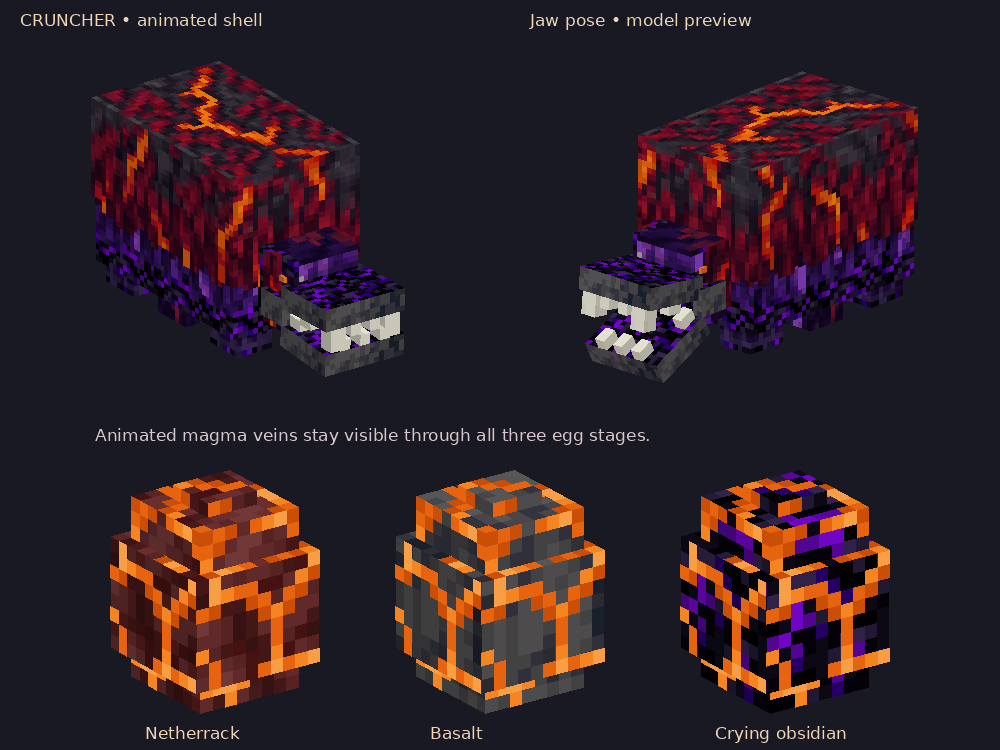
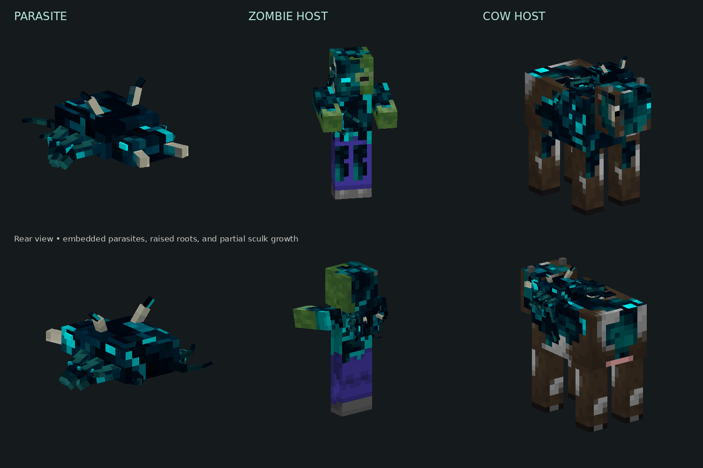

# Minecraft: Sniffer Head

A NeoForge mod for Minecraft 26.3 using Java 25. **Sniffer Head** is a placeable
sniffer head with a red head, floppy ears, and yellow snout. Find it in the
Building Blocks creative tab or Example Mod Tab. Side placements sit flush against the wall and face outward from the clicked block face;
top placements face the player in 16 steps of 22.5 degrees, including diagonals.

Sniffers drop one Sniffer Head on death when mob loot is enabled. It has no
random drop chance or Looting bonus, and does not require a player kill.

Start with [the beginner guide](START_HERE.md) for setup, run commands, and an
explanation of the Java and JSON files. Open this repository folder directly
in IntelliJ as a Gradle project; the original template ZIP is kept for reference.

Existing Example Blocks turn into Sniffer Heads: the saved block and item ID
remains `examplemod:example_block`. The model references the vanilla sniffer
texture, so no copy of Minecraft's texture is bundled in this repository.

The template's example food item, configuration, and logging remain in place.

## Sniffing ancient debris

Adult sniffers can dig exposed, reachable ancient debris on a walkable surface.
When their normal digging animation reaches its reward moment, the debris
breaks and drops **one Netherite Scrap** and **one Ancient Artifact** instead of
seeds or an ancient debris block. Buried debris is untouched. Mob griefing must
be enabled. Normal sniffer restrictions and digging cooldowns still apply.

Ancient Artifact is a placeholder item using a vanilla pottery-sherd icon. Find
it in Ingredients or Example Mod Tab, or use `/give @s examplemod:ancient_artifact`.

## Cruncher progression

A successful ancient-debris excavation has a **1-in-15 chance (about 6.7%)** to
also drop **one Cruncher Egg**, matching the vanilla Sniffer Egg chance from
warm-ocean-ruin suspicious sand. Scrap and the ordinary artifact remain guaranteed.
Place the egg with room above it: it hatches into a baby Cruncher on the vanilla
Sniffer Egg timing: about **20 minutes**, or **10 minutes on warped nylium**, plus a small
random delay for each of its three stages.
The baby grows up after about **one minute** in this testing build.

The Cruncher is a passive, fire-immune Nether relative of the sniffer with six
legs, a charcoal/magma hide, and oversized animated jaws. Adult Crunchers search
within eight blocks for reachable Ancient Geodes, walk beside them, and crunch
them into **one Rare Ancient Artifact**. Geodes come from ominous-vault rewards
with a **20% chance (1 in 5)** per reward. Normal vaults do not gain them.
The geode has a stepped dragon-egg shape with a dark shell and purple crystal.

Feed Crunchers **Wither Roses** to breed them; they lay a hatchable Cruncher Egg.
Wither Roses also speed up baby growth, and Crunchers follow players holding them.

Cruncher Egg and Ancient Geode are in Natural Blocks and Example Mod Tab.
**Cruncher Spawn Egg** is in Spawn Eggs and Example Mod Tab; using it immediately
spawns an adult Cruncher. Its Nether-colored icon uses the vanilla magma-cube
spawn-egg texture. Give it with `/give @s examplemod:cruncher_spawn_egg`.
Rare Ancient Artifact is in Ingredients and Example Mod Tab. These items can be
obtained with `/give`; the mob can be spawned with `/summon examplemod:cruncher`.
Both artifacts remain placeholders for future components. Crunchers do not
spawn naturally yet; eggs are their survival acquisition route.

## Cruncher and egg visuals

The hatchable Cruncher Egg has a custom flat obsidian-and-magma inventory icon.
All three egg stages keep their netherrack, basalt, and crying-obsidian transition,
with animated magma veins across every face. The Cruncher keeps the sniffer's
moss fringe and six-legged silhouette, with a Nether recolor, crying-obsidian
body, animated shell veins, armored jaw hinges, and individual crushing fangs.

This preview is rendered from the actual model UVs and texture frames; in-game
lighting can differ. Texture animation is handled by the client renderer and
block texture metadata. Feeding, hatching, AI, drops, loot chances, collision,
and combat behavior are unchanged by this visual update.

## Skulk Parasite

A small, six-legged sculk creature seeks a nearby **vanilla zombie or cow**, leaps
onto it, and merges into that host. One successful infection consumes the parasite.
Players and other mob types cannot be infected, and infected hosts cannot be
infected again. A host does not spread infection by attacking.

- **Skulk Zombie:** keeps zombie behavior, with 30% faster base movement, 50%
  stronger base attacks, and 10 base XP instead of 5. Equipment and difficulty
  still affect combat and XP under the normal rules.
- **Skulk Cow:** keeps the cow body and ordinary cow loot, but chases and attacks
  Survival/Adventure players. Creative and Spectator players are not targets.
- Infection survives saving/loading. Names, equipment, age, health and other
  standard conversion data are carried over; infection is not a host death.

Parasites naturally spawn **only in the Deep Dark or Ancient Cities**,
one at a time. An otherwise-valid natural spawn has a **1-in-10 chance**, and
new natural spawns are blocked when **two living parasites are within 32 blocks**.
Normal monster darkness, difficulty, space and mob-cap rules also apply.
The Ancient City entry is required because cities override biome spawning with
an empty monster list; it uses the same rarity and population checks.
Parasites produce no movement vibrations and their own vibrations are ignored
by sculk sensors and other vibration listeners, like the Warden's. Infected
zombies and cows still produce their normal vibrations. Spawn eggs and commands can place them anywhere for testing.
Only the parasite has a creative spawn egg; the two infected host types are
created by infection. Find **Skulk Parasite Spawn Egg** in Spawn Eggs or Example
Mod Tab, or use `/give @s examplemod:skulk_parasite_spawn_egg`.

For a quick test, put a zombie or cow and a parasite in a small enclosure.
Use `/summon examplemod:skulk_parasite`, `/summon minecraft:zombie`, or
`/summon minecraft:cow`. Keep zombies shaded. Switch to Survival to see an
infected cow attack. `/locate biome minecraft:deep_dark` and
`/locate structure minecraft:ancient_city` help find natural habitat.

Infected hosts keep their native skins beneath patches of sculk. Growth spreads
from a zombie's shoulder across part of the face, shirt, and upper legs, or along
a cow's spine, both flanks, face, and upper legs. One eye turns cyan while the other stays normal. Raised
roots and small sculk plates join these patches to the parasite embedded in the
host. Most skin, clothing, coat markings, and legs remain visible.

The parasite combines a broad, ridged carapace, six bent supporting legs, two
pale sensory horns, and bone pincers with four fine curling tentacles. The free
and attached versions share this design and restrained animation. Attachments
follow the host's body and head poses; separate growth masks fit baby skins.

[Watch the tentacle animation preview](docs/visuals/skulk-parasite-tentacles.gif)

[Inspect the baby host skins and fitted attachments](docs/visuals/skulk-baby-hosts-preview.png)

For an in-game visual check, infect an adult zombie and cow, walk around to see
the fused parasite and growth from the front and back, and compare against uninfected
mobs. Check a baby host and an armored zombie as well. The original skins come
from Minecraft's resources, so resource-pack skins remain visible outside the
sculk patches. Armor may cover parts of the growth.

This is a software preview using the model UVs; Minecraft lighting can differ.

For the client rendering regression check, run `./gradlew runSculkRenderCheck`
(or `.\\gradlew.bat runSculkRenderCheck` in Windows PowerShell). It opens the
Minecraft client, checks loaded host models and packaged growth textures,
verifies the cutout pass, drawing order, tint, invisibility, and glowing state,
and closes automatically. CI runs this under a virtual display. This checks
renderer submissions; the previews and in-game appearance still need visual review.
