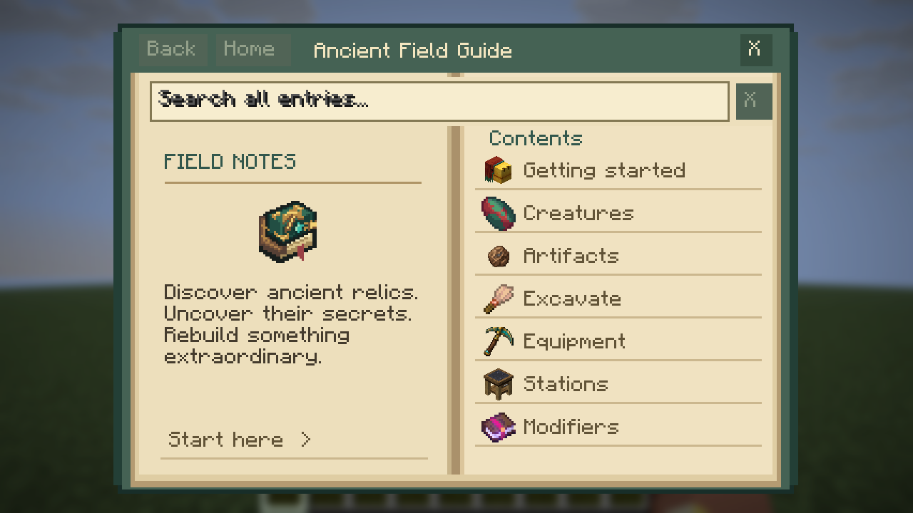
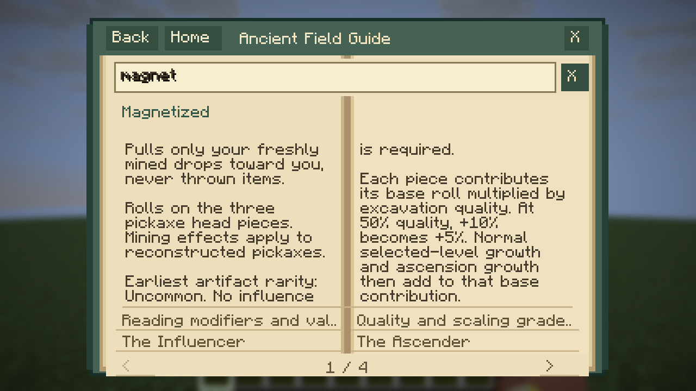

# Book review from the actual Minecraft client

Historical baseline before the five-edition redesign. See [the current comparison and native evidence](FIVE_BOOK_REVIEW.md) for the replacements.

Status: **functional pilot passes; visual/usability review fails**. This is the baseline to fix in the next book-design change, not an approval of the current interface.

Captured with Minecraft 26.3, NeoForge 26.3.0.77 and Mesa software OpenGL in a newly created Creative/Superflat world. The driver used real X11/SDL mouse and keyboard input. These images come directly from the game window. The test created the world, navigated the guide, searched, followed links, changed pages, resized the window and tested Escape, Close and reopening. It produced 15 screenshots plus video. The scripted task paths are simulated perspectives, not a human user study.

## Observed issues

| Priority | Evidence | Observation | Direction for the redesign |
|---|---|---|---|
| High | Contents and modifier captures | Search text looks doubled/overprinted or heavily offset by its shadow. It is visibly worse than the plain text in the layout-only previews. | Fix the native edit-field rendering and inspect focused, empty and populated states in game. |
| High | Article capture | The footer paper extends into/outside the cover frame and obscures the bottom edge. | Keep navigation inside a reserved footer with a continuous book boundary. |
| High | Introduction and modifier captures | Narrow columns split paragraphs into awkward carryovers. A modifier page can begin with just “is required.” from the previous column. | Lay out whole information sections deliberately rather than splitting a flat string list into fixed line counts. |
| Medium | Introduction | The long article heading crosses the spine rather than sitting comfortably on a page or a deliberate full-spread title area. | Give headings a defined region and a consistent hierarchy. |
| Medium | Modifier capture | The first spread spends most of its space on shared quality/roll explanations; the interesting modifier-specific values are pushed into later spreads. Magnetized needs four spreads. | Put what the modifier does and its useful numbers first. Move repeated system rules to their own clearly linked reference. |
| Medium | Article captures | Four repeated related links take a large part of the reading area and truncate their labels. | Use fewer contextual links with readable names. |
| Medium | Contents and the user's icon feedback | The ornate icon and flat panel composition need an art/style pass. Rendering correctly is not evidence that their design is good. | Redesign the icon and page treatment alongside the hierarchy, using Minecraft-sized silhouettes and in-game checks. |

## Pilot perspectives

| Perspective | Functional outcome | Visual/usability assessment |
|---|---|---|
| New archaeologist | Reached the introduction, followed the Sniffer link and returned successfully. | The entry path works, but competing start choices and the dense, awkwardly split introduction need simplification. |
| Returning player | Searched for Magnetized, opened it, turned a page and returned to the preserved search. | Search is easy to locate but its rendering is faulty. Useful details take too much reading to reach. |
| Equipment builder | Browsed area modifiers, opened an article and used the book at two scales/window sizes. | Navigation works. The repeated links, truncation and paragraph flow make comparison harder, particularly in the smaller window. |

## Actual window captures

### Contents at 1280×720, GUI scale 3

### Magnetized article at 1280×720, GUI scale 3

The full run artifact contains the remaining captures and video. See [Real-client QA](REAL_CLIENT_QA.md) for reproduction and inspection instructions. Automated success must continue to be reported separately from visual approval.
