# Five guidebook designs: review and finalists

**Recommended comparison set: Workshop Manual, Trail Guide and Relic Atlas.** They are the first three items in the mod's creative tab. Workshop Manual replaces the existing guide in place and keeps its book + paper recipe and registry ID, `examplemod:ancient_field_guide`. Existing books therefore open the Manual. All editions contain the same 147 searchable entries; none changes gameplay.

This is a **five-persona simulated evaluation**, not feedback from five people. I inspected actual Minecraft window captures and used reproducible mouse/keyboard tasks. Scores are qualitative design judgments, not measured user-success rates. The user's in-game comparison is the next test.

## What changed after critical review

| Finding | Consequence | Revision |
|---|---|---|
| Old entries split sentences across a crease and hid specific effects behind repeated rules | Hard to follow an explanation or look up a modifier | Named sections; Effect first; a section's paragraphs paginate independently. Long column text breaks at sentence boundaries where possible. |
| First native screenshots still showed a nearly black search placeholder | Search looked broken even though typed text worked | Removed the native hint rendering; a single high-contrast, unshadowed placeholder now remains visible whenever the input is empty, including keyboard autofocus. Native typed text, selection and caret remain native. |
| Full category names were truncated in short tabs | Novices had to guess the destination | Short labels and measured ribbon widths, with full Modifiers text; complete article titles remain available in the reading view. |
| An earlier page background ended above the footer buttons | Footer appeared to hang outside the book | Extended the paper/footer surface within the leather frame. |
| Detailed tier probabilities overwhelmed the value ranges | Too much paging to answer “how strong can this be?” | Compact strongest-first T1… ranges in Value tiers; family weights, rarity weights and eligibility in Roll odds. Growth and ascension resources have their own sections. |
| The first tutorial route detoured through Cruncher hatching before the first tool | Suggested an optional creature was a mandatory first step | The task route now goes Find → Uncover → Build → Understand → Customize → Ascend. Creature details remain in their category. |
| Generic section labels such as “Details 3” offered no clue | Players could not choose the useful explanation | Short task-specific labels such as Food, Hatch time, Recover, Permanent and Costs. |
| A wider book could exceed Minecraft's minimum 320-pixel GUI width | Parts of the page and buttons could leave the window | The layout fits horizontally without shrinking the native font; measured wrapping and widget bounds use the same fitted coordinates. |
| Five content copies would become expensive to maintain | Future features could diverge between editions | One structured chapter source and one runtime modifier library feed every presentation. Removed the obsolete book renderer and moved its input checks to the new designs. |
| The old ornate icon read poorly at inventory size | The guide was difficult to recognize | Five new generated book covers, with large silhouettes, cream page edges and distinct symbols/colors. Actual hotbar rendering is part of the review. |

## Persona review

Scores run from 1 (obstructive) to 5 (strong). A 3 means passable with a noticeable tradeoff. No design is a universal winner.

| Simulated reviewer | Field Journal | Workshop Manual | Trail Guide | Pocket Reference | Relic Atlas |
|---|---:|---:|---:|---:|---:|
| Rowan: Minecraft newcomer, no mods | 4 | 4 | 5 | 3 | 4 |
| Alex: vanilla veteran, first content mod | 4 | 5 | 4 | 3 | 4 |
| Morgan: casual user of several mods | 4 | 5 | 4 | 4 | 4 |
| Sam: experienced modpack/equipment builder | 3 | 4 | 4 | 5 | 4 |
| Casey: returning player, small window | 4 | 4 | 4 | 3 | 4 |
| **Mean heuristic score** | **3.8** | **4.4** | **4.2** | **3.6** | **4.0** |

- **Rowan:** The Manual's “What would you like to do?” and the Trail's numbered tasks expose concrete first actions. The Atlas needs an extra category selection. The Reference is usable through its “New here?” action, but the initial 147-entry list distracts from starting. Vanilla terms such as suspicious sand and ancient debris still require some Minecraft knowledge; the Trail provides the clearest route, while the Manual offers more choices at once.
- **Alex:** Searching ordinary words such as “wither rose” reaches Cruncher food. Named sections separate hatching time, speed boost and space requirements. A ribbon uses short labels; fuller subject names and the search field provide the context.
- **Morgan:** Following excavation → related tools → Back restores the exact excavation section. Recover has a dedicated section explaining the empty output requirement. The Manual retains categories while reading and highlights the current article's subject even when it was reached through search, reducing detours.
- **Sam:** Effect, cap/eligibility, value ranges, weights, growth and resources are separated. The Reference's persistent result list is fastest for hopping among definitions, but leaves less room for each explanation. The Atlas's section rail is easier to scan than the Journal's reading columns.
- **Casey:** Search, clear/no-match recovery, native keyboard activation, Escape and per-edition bookmarks work across the five items. The smaller 854×480 and minimum-width 640×480 captures retain controls and readable body text. The Reference has two independent page controls and a narrow reading area, creating the largest navigation cost.

## Icon review

At actual inventory size, all five now read as closed books with a page edge and a large cover symbol. They do not depend on color alone. Heuristic recognizability scores: Journal **4/5**, Manual **5/5**, Trail **4/5**, Reference **4/5**, Atlas **4/5**. The Manual's pale anvil has the clearest contrast; the green Journal is darker in hand. The hotbar capture below records the actual five sprites, not enlarged source artwork. Icon quality was a pass criterion alongside navigation, reading and explanation; the primary ranking remains usability.

## Why these three

| Rank | Edition | Strength | Remaining tradeoff | Inventory icon |
|---|---|---|---|---|
| 1 | **Workshop Manual** | Best balance of task entry points, persistent categories and readable explanations | Sidebar reduces reading width slightly | Blue book, pale anvil, silver clasp |
| 2 | **Trail Guide** | Clearest first-tool route and widest reading area | A guided route is less useful to an expert | Red book, cream compass arrow |
| 3 | **Relic Atlas** | Clear visual subjects and a permanently visible section rail | More Home/category navigation than the Manual | Tan book, green leaf |
| 4 | Field Journal | Familiar two-page book form, obvious start action | Columns require more scanning and pagination for long definitions | Green book, pale pickaxe |
| 5 | Pocket Reference | Efficient repeated lookups beside a live result list | Denser, more abbreviated list labels, two pagination contexts | Purple book, cyan glyph |

All five reached a passable state for these simulated tasks. The two non-finalists remain registered for development comparison, but are absent from creative tabs and recipes:

```mcfunction
/give @s examplemod:field_journal
/give @s examplemod:pocket_reference
```

Finalists can also be obtained with `/give @s examplemod:ancient_field_guide`, `/give @s examplemod:trail_guide`, and `/give @s examplemod:relic_atlas`.

## Native evidence and checks

Screenshots below are from the actual Minecraft 26.3/NeoForge client. They are not reconstructed UI drawings. The workflow creates a real Creative/Superflat world, supplies five fixture books, selects hotbar slots and opens each through ordinary right-click item use. Navigation input travels through xdotool → X11 → SDL → native widgets. Captures and video are retained in the workflow artifact.

**Implementation tested:** `f24b720b1d0e26b4c75d0cd8b3497dfe1ae91860`.

- [Native Minecraft run: 63 window captures, video and action/state timeline](https://github.com/Stonewizzard/mod/actions/runs/39992749607). All five actual book items passed their OS-input scenarios.
- [Build, 24 required server GameTests and client rendering checks](https://github.com/Stonewizzard/mod/actions/runs/39992749558). The layout check covered **7,210 section/design/width combinations**, plus native widget dispatch at three offsets and five complete icon/model resource sets.
- The following commit adds this evidence and documentation only; the tested Java, assets, content and QA driver remain identical.

### Finalists

**Workshop Manual — task list and persistent contents**

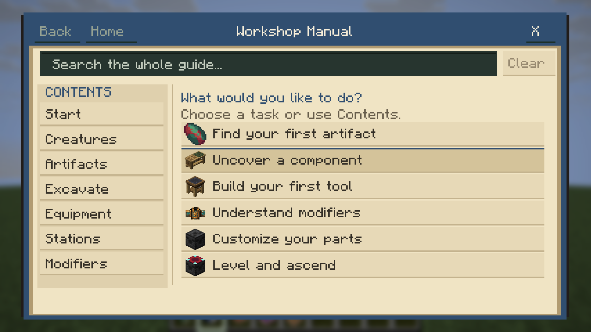

**Trail Guide — first-tool route and category ribbon**

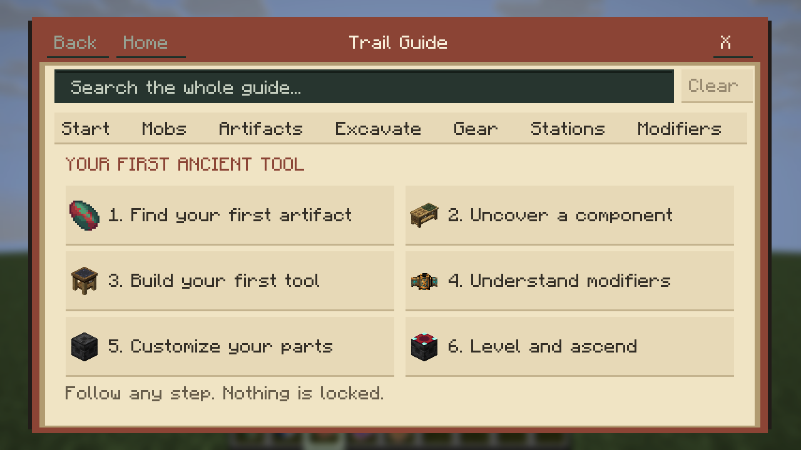

**Relic Atlas — illustrated category cards and a section rail**

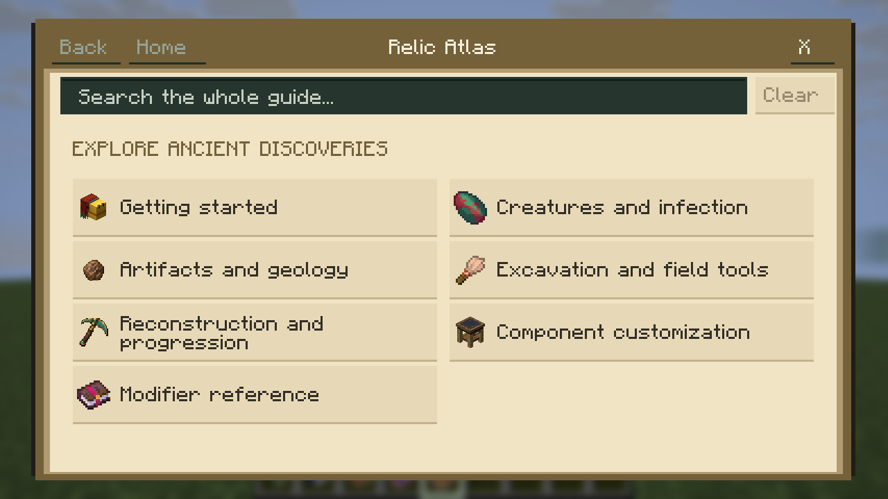

### Reading and modifier information

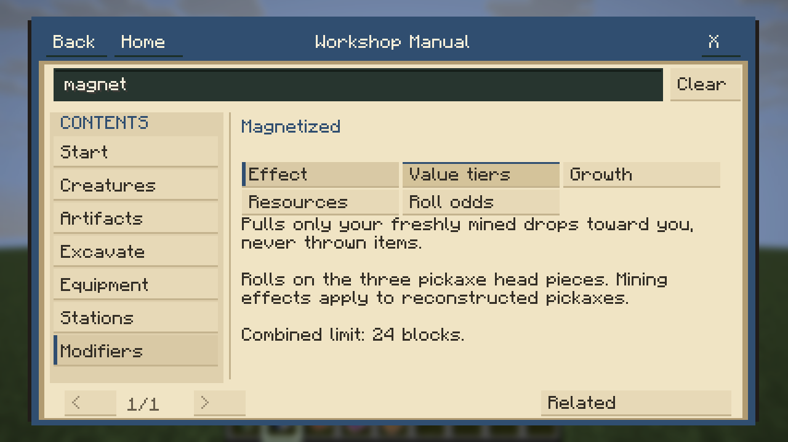

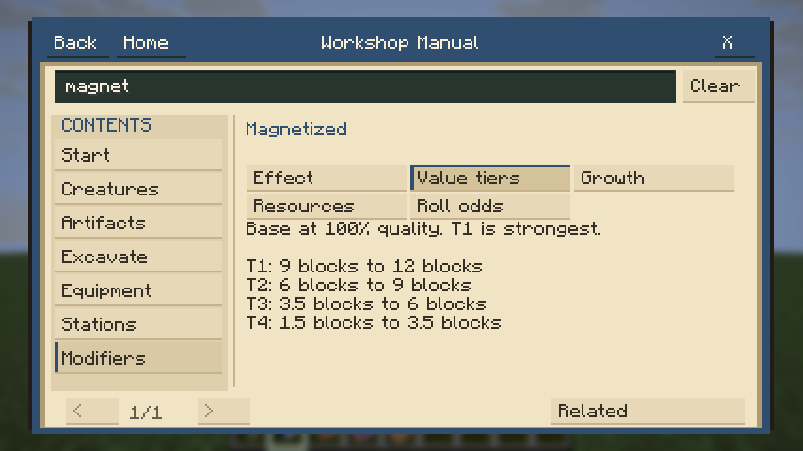

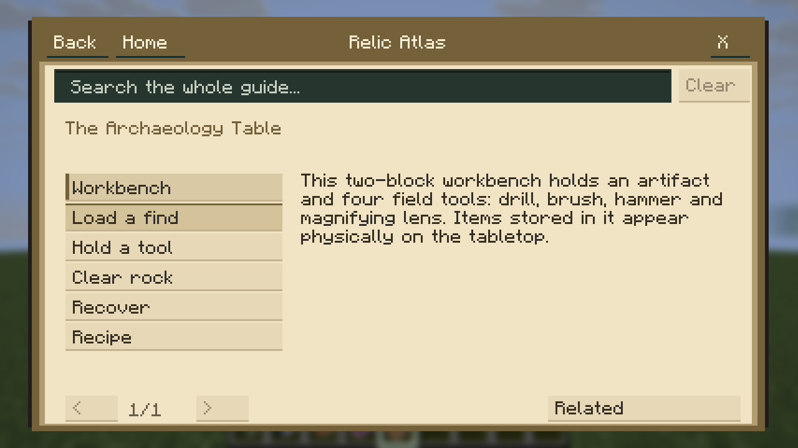

<details>
<summary>Minimum-width captures: all three finalists at 640×480</summary>

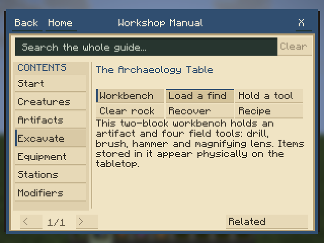

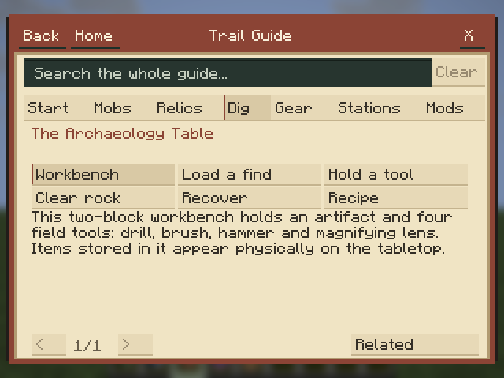

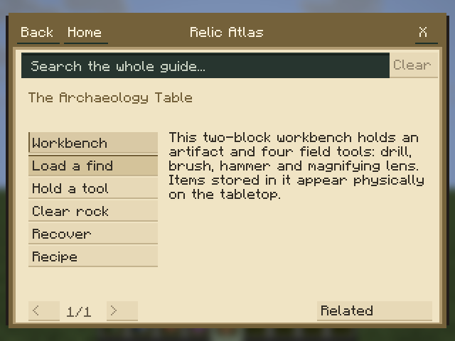

</details>

<details>
<summary>The two remaining prototypes and their narrow-window tradeoffs</summary>

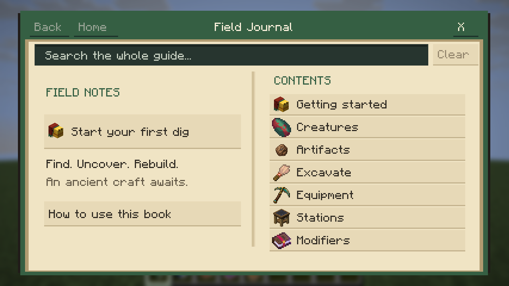

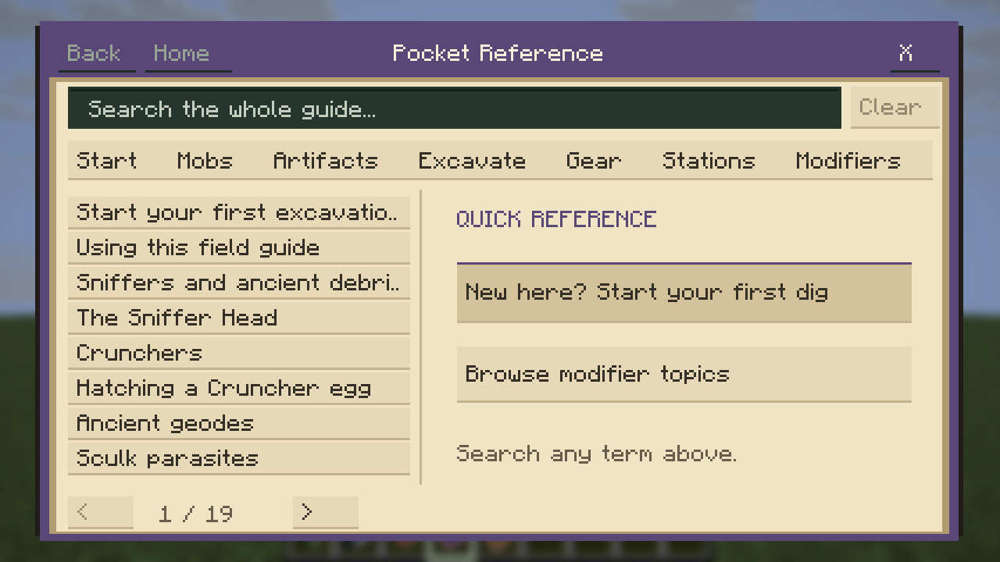

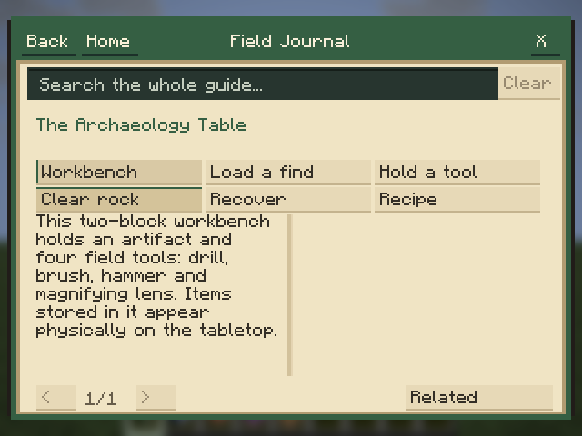

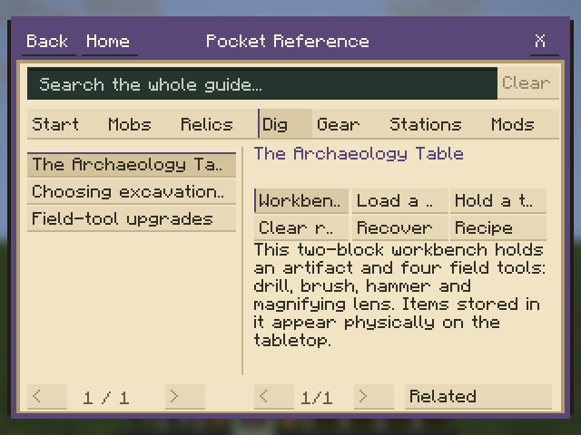

</details>

### Actual inventory icons

The five fixture items, left to right: Journal, Manual, Trail, Reference, Atlas. Normal creative tabs expose Manual, Trail and Atlas.

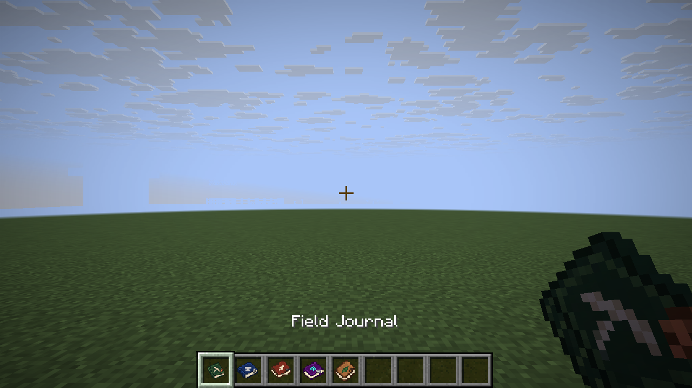


The native scenarios cover each edition's first action; categories and modifier topics; global multiword search; empty results and Clear; Effect/tier/growth sections; related links and restored section history; GUI scales 2/3; 1280×720, 854×480 and 640×480 windows; Escape, Close, keyboard Tab/Return, and reopening a bookmarked section. The inventory capture checks the five real icons.

Additional checks cover all 27 chapters and 120 live modifier entries, every named section in every layout, font-measured body bounds, overlapping/duplicate controls, native primary-click validation at three offsets in all five layouts, five item/model/texture resource sets, read-only item use and saved equipment data, and the existing server gameplay regression suite.

## Limits and next decision

This establishes functional coverage and a critical visual review, not real-player comprehension or preference. English text and software-rendered CI windows were tested; localization, narrator output and other resource packs need separate review. Long articles still paginate, particularly in the Journal and Reference. Recipe sections currently describe real grid rows and ingredients in text; illustrated crafting grids would be a useful later addition. These prototypes deliberately emphasize clear paper, headings and controls over elaborate animation. The user's choice among the three finalists should determine the single long-term edition before adding more visual polish.

To add content, see [GUIDEBOOK_AUTHORING.md](GUIDEBOOK_AUTHORING.md). Chapters, recipes, links and search keywords are authored once; new modifier explanations derive from live gameplay definitions. New entries require no per-edition UI edits.
