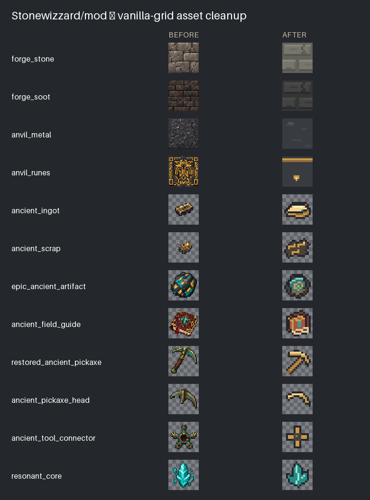

# Minecraft asset authoring

The archaeology assets use a 16×16 logical pixel grid, small palettes and binary
alpha. PNGs remain 32×32 because existing excavation, reconstruction and guidebook
screens address 32px textures. Every logical pixel is an exact 2×2 square; this is
visually the same pixel density as vanilla 16px artwork. There is no resampling at
runtime and no change to UI texture coordinates.



This is an asset contact sheet, not a Minecraft screenshot. Native comparison
captures are in the Real Minecraft visual QA workflow artifact, named
`assets-vanilla-comparison-ingot`, `-scrap` and `-artifact`. The fixture places
vanilla stone bricks, forge bricks, iron and ancient metal next to vanilla and
ancient anvils. Its hotbar includes vanilla iron/gold and ancient ingots, and the
player holds vanilla iron in the offhand for a direct held-size comparison.

## Reusable skill

The repository's [Minecraft asset skill](../.agents/skills/minecraft-assets/SKILL.md)
is discovered through root `AGENTS.md`. It covers authoring, model wiring,
transparency, icon extent, material scale, collision and in-game review. It is
versioned with the mod, so future work can use the same conventions.

Install `tools/requirements-assets.txt`, then run:

```sh
python tools/generate_pixel_assets.py
python tools/generate_pixel_assets.py --check
python tools/check_pixel_assets.py
python tools/test_pixel_asset_checks.py
```

The generator owns 43 ordinary item sprites and 13 workshop materials. The gate
checks all generated outputs for grid alignment, palette size and alpha. Item
checks additionally require a clear one-pixel logical margin, an 11–14px longest
dimension, no enclosed transparent pinholes and no detached tiny fragments.
Existing large entity textures, excavation-board artwork and animated egg block
materials have separate authoring requirements and are outside this generic gate.

The eight negative-control tests introduce bad alpha, a pinhole, a loose pixel,
an undersized icon, a misaligned pixel, edge clipping and a transparent block.
They verify rejection alongside a valid sprite. CI runs generation freshness,
the asset gate and its negative controls independently of the Java build.

The gate catches mechanical problems; it cannot judge whether an item is beautiful
or whether two materials fit the same scene. Review contact sheets and actual
Minecraft captures before approving art changes. New shape families need their own
authored silhouettes. Intentional holes and separate fragments need explicit,
documented per-asset allowances rather than weakening the generic checks.

## Anvil

The starter anvil keeps its one-cell footprint and unchanged saved IDs, recipes,
foundation tiers and interactions. The work face, horn, waist and foot use nine
whole-pixel boxes rather than seventeen finely layered boxes. Its collision shape
comes from the same source as its model; the warm glow follows the new top.
Dense rune wallpaper and gold plate stacks are replaced with quiet dark metal and
a small maker's mark. A future larger tier should own its neighboring cells rather
than stretching this model outside its placement/collision space.
