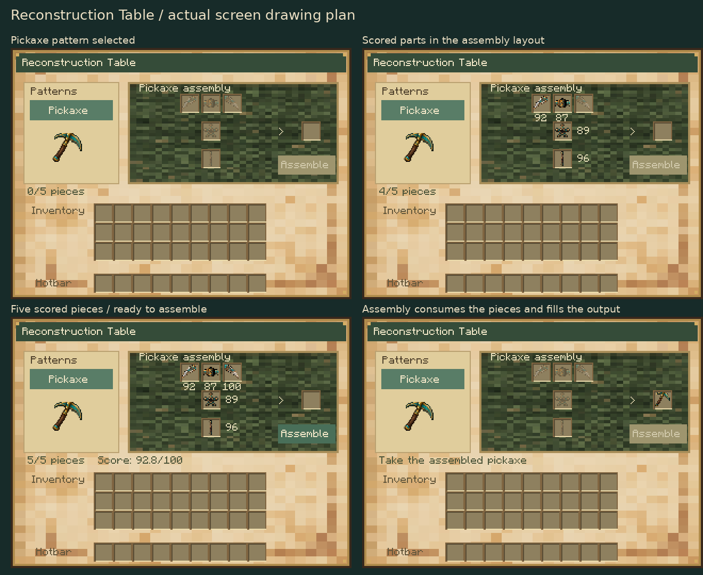

# Reconstruction Table

A starter archaeologist's workbench for piecing together the work of ancient master smiths. This is the first reconstruction tier; a more elaborate ancient forge and equipment modifiers are future work.

## Craft and place

Craft with three planks, one crafting table and two sticks:

```
Plank  Plank  Plank
       Table
Stick         Stick
```

Place the single-block bench and right-click it. It appears in Functional Blocks and Example Mod Tab. `/give @s examplemod:reconstruction_table` also provides it for testing.

## Select and assemble a pickaxe

Click **Pickaxe** in the Patterns panel. More tool patterns can be added later. The five slots follow this blueprint:

```
Left tip    Head bridge    Right tip
                 *
                 |
```

The star is an **Ancient Tool Connector** and the vertical slot is an **Ancient Tool Handle**. The three upper pieces form the `/ - \` head. Each slot accepts only its matching component. Shift-click routes a piece into the right slot.

Insert all five pieces and click **Assemble**. They become one usable **Restored Ancient Pickaxe** in the output slot. Take the output before assembling another. Stored pieces remain in the bench when it is closed and survive saves. Breaking the bench returns its pieces and any completed output.

## Excavation finds

New metal inclusions can reveal:

- Ancient Pickaxe Left Tip — `examplemod:pickaxe_left_tip`
- Ancient Pickaxe Head Bridge — `examplemod:pickaxe_head_bridge`
- Ancient Pickaxe Right Tip — `examplemod:pickaxe_right_tip`
- Ancient Tool Connector — `examplemod:ancient_tool_connector`
- Ancient Tool Handle — `examplemod:ancient_tool_handle`

Each has its own large excavation silhouette and inventory icon. The five pieces share the existing metal-find pool with sword blades and axe heads. The existing alloy/core chances, source rarity weights and Sniffer/Cruncher behavior remain intact. Legendary and Unique still have no natural acquisition chances.

Existing sealed specimens retain their original contents, including whole pickaxe heads. Existing whole heads and their crafting recipe remain compatible; new pickaxe-component finds use the Reconstruction Table.

## Scores and future modifiers

A recovered component retains its excavation condition as an exact score out of 100, along with the original rarity, rock matrix, seed, find type and stroke count. Its normal item information displays **Excavation score: 92/100**. Removing it from the table, storing it, dropping it or reloading does not erase that record.

Reconstruction copies the original record of **every piece** onto the finished pickaxe, under `examplemod:reconstruction` in custom data. It also records the total and average score. For example, scores of 92, 87, 100, 89 and 96 give an assembly score of **92.8/100**. The item displays this average in its normal item information. Individual piece records remain available so later modifiers can use their own component's percentage instead of relying solely on the average.

This does not yet scale mining speed, durability or other modifiers. The pickaxe uses its current fixed diamond-level tool properties and 1,800 durability. Low-condition salvage remains ordinary fragments rather than assembly pieces.

Creative components obtained directly with `/give` have never been excavated. They display `--` in the bench, carry a `Scored: false` flag when assembled, and contribute zero to the average instead of being assigned a fictitious perfect score. Their pickaxe remains usable for testing.

## Review



The preview is rendered from the screen's actual Java drawing plan, packaged item textures and Minecraft font. It is not a live graphical client recording.

Automated checks cover native pattern/assembly packets, every new excavation silhouette, individual and aggregate scores, item/table serialization, matching-slot shift-click, full-output and distance protection, two-player duplicate prevention, the block recipe and inventory drops on breaking. Hands-on playtesting should focus on the feel of assembling the five pieces and their availability during normal excavation.
